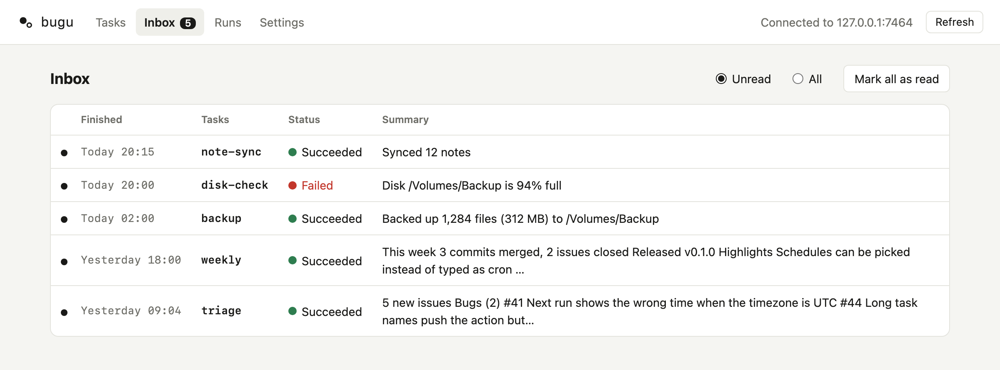

# Bugu

English | [简体中文](README.zh-CN.md)

A desktop-first scheduled task app. Have command-line agents such as Claude Code, Codex and Pi, or plain scripts, do work on a schedule and bring the results to you, without writing config files.

The name comes from the cuckoo (布谷, *bùgǔ*), the bird that calls out the hour.


## Features

- **Three ways in**: a desktop app that lives in the menu bar, a web panel, and a CLI. All of them talk to the same daemon.
- **Scripts and AI CLIs**: run a command, a script file, an AI CLI with a prompt, or several of them as steps that pass output along.
- **Schedules without cron**: pick "every weekday at 09:00" from a form, or type a cron expression if you prefer. Each run can start at a random offset around the set time.
- **Results come to you**: every run lands in an inbox, with Markdown output rendered. Optional system notifications and webhooks.
- **Safe by default**: AI CLIs run read-only unless you allow more. Secrets in env files are hidden in output, logs and notifications.
- **Remote hosts**: manage a Bugu running on a server from your laptop, with per-machine tokens.

Pick a schedule instead of writing cron:


Every run's results go to the inbox:



A multi-step run shows each step's status:


## Build

Requires Go 1.27 or later.

```sh
make build    # produces bin/bugu
make app      # packages the desktop app into dist/ (macOS)
```

## Getting started

### Desktop app

Run `bin/bugu app`, or open the app bundle produced by `make app`. Closing the window leaves it in the menu bar, and tasks keep running.

### Command line

```sh
bin/bugu serve                # start the daemon (not needed while the desktop app is open)
bin/bugu add backup --schedule "0 2 * * *" --command "~/bin/backup.sh"
bin/bugu list
bin/bugu run backup           # try it now instead of waiting for 2 a.m.
bin/bugu runs
bin/bugu logs <run-id>
```

### AI CLIs

```sh
bin/bugu runner check         # which AI CLIs are installed here and whether they start
bin/bugu add issues --schedule "0 9 * * 1-5" --runner claude --cwd ~/projects/site \
  --prompt "List new issues since {last_run} and sort them into bugs, feature requests and questions."
```

AI CLIs run read-only by default; add `--permission write_cwd` when one really needs to change files.

To let your own AI agent create tasks, save the output of `bin/bugu skill` as that agent's skill file (for Claude Code, `~/.claude/skills/bugu/SKILL.md`). It will then use `bugu ... --json` to create tasks, try them and read the results.

### Servers and remote hosts

```sh
bin/bugu daemon install       # run the daemon as a system service (launchd on macOS, systemd on Linux)
bin/bugu web                  # on a machine without a desktop: start the daemon and open the web panel
bin/bugu token create laptop  # on the server: create a token for another computer
bin/bugu host add nas https://bugu.example.com --token -   # on your computer: register the server, token read from stdin
bin/bugu --host nas list      # run commands against it; its panel also opens from the app's settings page
bin/bugu doctor               # check the environment
```

The interface and CLI messages are available in English and Chinese: run `bin/bugu language en`, or choose on the settings page.

Run `bin/bugu help` for all commands.

## Development

```sh
make check    # formatting, static checks, all tests, cross-compilation, web checks and browser tests
```

`make check` also needs Node; the first run downloads Chromium for the browser tests.

- Requirements: [docs/PRD.md](docs/PRD.md)
- Architecture: [docs/ARCHITECTURE.md](docs/ARCHITECTURE.md)
- Design decisions: [docs/adr/](docs/adr/)
- Contributing, for humans and AI agents: [AGENTS.md](AGENTS.md)

## License

[MIT](LICENSE)
