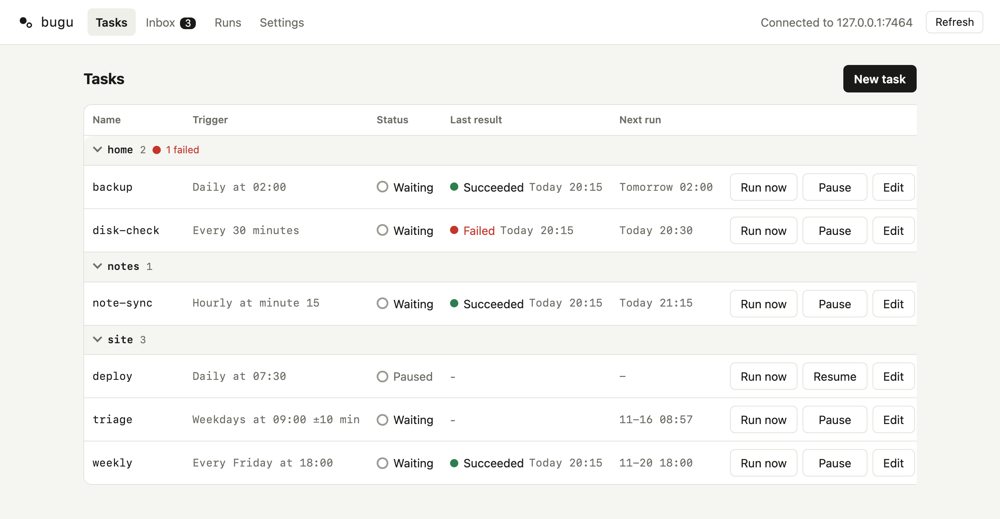

# Bugu

English | [简体中文](README.zh-CN.md)

A desktop-first scheduled task app. Run scripts and command-line AI agents such as Claude Code, Codex and Pi on a schedule, and collect the results in an inbox. Tasks are set up from a form or a single command.

The name comes from the cuckoo (布谷, *bùgǔ*), the bird that calls out the hour.



## Features

- **Desktop app, web panel and CLI**: the desktop app lives in the menu bar; all three talk to the same daemon.
- **Scripts and AI CLIs**: run a command, a script file, an AI CLI with a prompt, or several of them as steps that pass output along.
- **Schedules without cron**: pick "weekdays at 09:00" from a form, or type a cron expression. Each run can start at a random offset around the set time.
- **Results in one place**: every run lands in an inbox with Markdown output rendered. Optional system notifications and webhooks.
- **Safe by default**: AI CLIs run read-only unless you allow more. Secrets from env files are hidden in output, logs and notifications.
- **Remote hosts**: manage a Bugu running on a server from your own computer, with a separate token for each machine.

## Requirements

- macOS or Linux. The desktop app is macOS only; on Linux, use the web panel and the CLI.
- Go 1.27.3 or later to build. There are no prebuilt binaries yet.
- For AI tasks, the AI CLI itself (Claude Code, Codex, Pi or another), installed and signed in. Bugu only starts it.

## Build

```sh
make build            # bin/bugu
make build-headless   # bin/bugu-headless, without the desktop app, for servers and containers
make app              # the macOS app bundle in dist/
```

`make app` signs the bundle for this machine only; other Macs will block it unless you configure a Developer ID. System notifications only appear from the packaged app.

## Getting started

### Desktop app

Run `bin/bugu app`, or open the bundle from `make app`. Closing the window leaves it in the menu bar, and tasks keep running.

### Command line

Without the desktop app, start the daemon in its own terminal:

```sh
bin/bugu serve
```

Then, in another terminal:

```sh
bin/bugu add backup --schedule "0 2 * * *" --command "~/bin/backup.sh"
bin/bugu list
bin/bugu run backup           # try it now instead of waiting for 2 a.m.
bin/bugu runs
bin/bugu logs <run-id>
bin/bugu inbox                # unread results
```

### AI CLIs

Bugu starts AI CLIs through runners. Claude Code, Codex and Pi are built in; add others with `bugu runner add`.

```sh
bin/bugu runner check         # which AI CLIs are installed here and whether they start
bin/bugu add standup --schedule "0 9 * * 1-5" --runner claude --cwd ~/notes \
  --prompt "Read the notes in this folder and list the three things to do today."
```

AI CLIs run read-only by default. When a task really needs to change files, add `--permission write_cwd` or `--permission full`; `bugu runner list` shows the levels each runner supports.

To let your own AI agent create tasks, save the output of `bin/bugu skill --lang en` as that agent's skill file (for Claude Code, `~/.claude/skills/bugu/SKILL.md`). It will then use `bugu ... --json` to create tasks, try them and read the results.


### Servers and remote hosts

```sh
bin/bugu daemon install       # run the daemon as a system service (launchd on macOS, systemd on Linux)
bin/bugu web                  # on a machine without a desktop: start the daemon and open the web panel
bin/bugu token create laptop  # on the server: create a token for another computer
bin/bugu host add nas https://bugu.example.com --token -   # on your computer: register the server, token read from stdin
bin/bugu --host nas list      # run commands against it; its panel also opens from the app's settings page
bin/bugu doctor               # check the environment
```

A token lets its holder create tasks, and so run any command on that host as you; give tokens only to machines you trust. The daemon only listens on `127.0.0.1:7377`. To reach a server from another machine, put an HTTPS reverse proxy in front of it, or start it with `bugu serve --listen <address>` on a private network.

## Data

Everything lives in `~/.bugu` as plain files: tasks, run history and output, tokens and registered hosts. Set `BUGU_HOME` to use another folder. Custom runners go in its `runners/` folder.

## Language

The interface is available in English and Chinese: choose on the settings page, or run `bugu language en`. CLI messages follow your locale (`LANG`); pass `--lang en` to override.

Run `bin/bugu help` for all commands.

## Screenshots

Every run's results go to the inbox:


A multi-step run, with a script step and an AI CLI step:


## Development

```sh
make check    # formatting, static checks, all tests, cross-compilation, web checks and browser tests
```

`make check` also needs Node; the first run downloads Chromium for the browser tests.

- Requirements: [docs/PRD.md](docs/PRD.md)
- Architecture: [docs/ARCHITECTURE.md](docs/ARCHITECTURE.md)
- Design decisions: [docs/adr/](docs/adr/)
- Contributing, for humans and AI agents: [AGENTS.md](AGENTS.md)

## License

[MIT](LICENSE)
