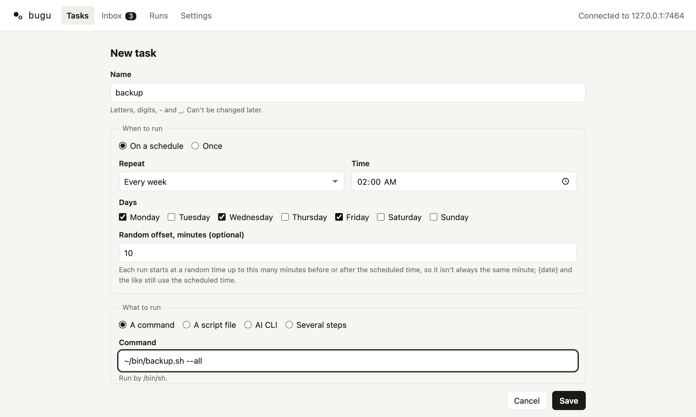
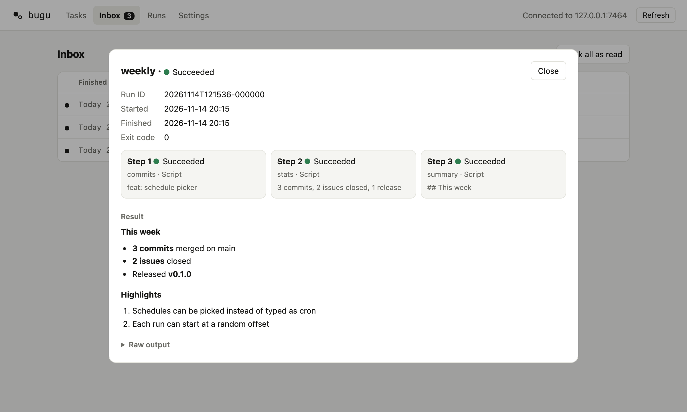

# Bugu

English | [简体中文](README.zh-CN.md)

A desktop-first scheduled task app. Have command-line agents such as Claude Code, Codex and Pi, or plain scripts, do work on a schedule and bring the results to you, without writing config files.

The name comes from the cuckoo (布谷, *bùgǔ*), the bird that calls out the hour.


**Status: the first version is feature-complete and awaiting acceptance.** Manage scheduled tasks from the desktop app, a browser or the command line. A task can be a script, an AI CLI, or several steps made of them. Results land in an inbox and can also go out as system notifications and webhooks. You can also manage another Bugu running on a server. Progress is tracked in chapter 11 of the requirements doc.

- Requirements and milestones: [docs/PRD.md](docs/PRD.md)
- Architecture: [docs/ARCHITECTURE.md](docs/ARCHITECTURE.md)
- Contributing (humans or AI agents): [AGENTS.md](AGENTS.md)

## Screenshots

Pick a schedule instead of writing cron. Each run can start at a random offset around the set time:



Every run's results go to the inbox; failures stand out at a glance:


A multi-step run shows each step's status, and Markdown output is rendered:



## Build

Requires Go 1.27 or later.

```sh
make build    # produces bin/bugu
make check    # formatting, static checks, tests, cross-compilation
make app      # packages the desktop app into dist/ (macOS)
```

## Try it

Desktop app: run `bin/bugu app`, or open the app bundle produced by `make app`. Closing the window leaves it in the menu bar, and tasks keep running.

Command line:

```sh
bin/bugu serve                # start the daemon and keep it running (not needed while the desktop app is open)
bin/bugu add backup --schedule "0 2 * * *" --command "~/bin/backup.sh"
bin/bugu list
bin/bugu run backup           # try it now instead of waiting for 2 a.m.
bin/bugu runs
bin/bugu logs <run-id>
```

Have an AI CLI work on a schedule:

```sh
bin/bugu runner check         # which AI CLIs are installed here and whether they start
bin/bugu add issues --schedule "0 9 * * 1-5" --runner claude --cwd ~/projects/site \
  --prompt "List new issues since {last_run} and sort them into bugs, feature requests and questions."
```

AI CLIs run read-only by default; add `--permission write_cwd` when one really needs to change files.

Let your own AI agent create tasks: save the output of `bin/bugu skill` as that agent's skill file (for Claude Code, `~/.claude/skills/bugu/SKILL.md`), and it will use `bugu ... --json` to create tasks, try them and read the results.

Servers and remote management:

```sh
bin/bugu daemon install       # install the daemon as a system service (launchd on macOS, systemd on Linux)
bin/bugu web                  # on a machine without a desktop: start the daemon and open the web panel
bin/bugu token create laptop  # on the server, create a token for another computer
bin/bugu host add nas https://bugu.example.com --token -   # on your computer, register that server; the token is read from stdin
bin/bugu --host nas list      # run commands against it; its panel can also be opened from the app's settings page
bin/bugu doctor               # check the environment
```

The interface and CLI messages are available in English and Chinese: `bin/bugu language en`, or pick it on the settings page.

See `bin/bugu help` for all commands.

## License

[MIT](LICENSE)
