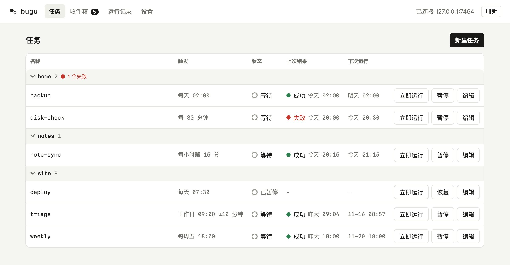
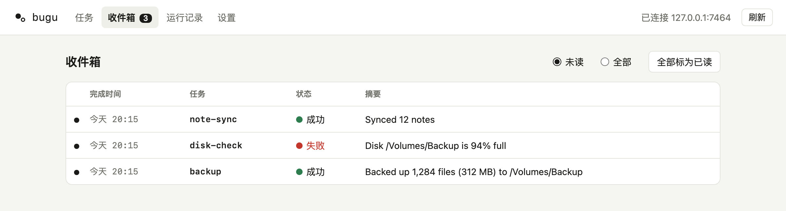

# Bugu 布谷

[English](README.md) | 简体中文

桌面优先的定时任务应用。让脚本和 Claude Code、Codex、Pi 等命令行 AI agent 按时运行,结果都进收件箱。任务在表单里填,或用一条命令建好。

名字取自布谷鸟:到点报时。



## 功能

- **桌面应用、网页面板和命令行**:桌面应用常驻菜单栏;三者连的是同一个后台。
- **脚本和 AI 命令行**:可以运行一条命令、一个脚本文件、带提示词的 AI 命令行,或把它们串成多个步骤,上一步的输出交给下一步。
- **不用写 cron**:在表单里选"工作日 09:00"这样的时间,也可以直接填 cron 表达式。每次可以在设定时间前后随机偏移。
- **结果集中在一处**:每次运行的结果进收件箱,Markdown 输出直接排版;也可以发系统通知和 webhook。
- **默认安全**:AI 命令行默认只读,需要时再放开。环境变量文件里的密钥在输出、日志和通知里都会隐藏。
- **远程主机**:在自己的电脑上管理服务器上的布谷,每台机器单独发令牌。

## 运行环境

- macOS 或 Linux。桌面应用只支持 macOS;Linux 上用网页面板和命令行。
- 构建需要 Go 1.27.3 或更高版本。暂时没有预编译的安装包。
- AI 任务需要先装好对应的 AI 命令行(Claude Code、Codex、Pi 或其他)并登录。布谷只负责启动它。

## 构建

```sh
make build            # bin/bugu
make build-headless   # bin/bugu-headless,不含桌面应用,用于服务器和容器
make app              # dist/ 里的 macOS 应用包
```

`make app` 只做本机签名,发到别的 Mac 上会被系统拦截,除非配置了 Developer ID。系统通知只有打包后的应用才能显示。

## 开始使用

### 桌面应用

运行 `bin/bugu app`,或打开 `make app` 生成的应用包。关闭窗口后它留在菜单栏,任务照常运行。

### 命令行

不开桌面应用时,先在一个终端里启动后台:

```sh
bin/bugu serve
```

再在另一个终端里:

```sh
bin/bugu add backup --schedule "0 2 * * *" --command "~/bin/backup.sh"
bin/bugu list
bin/bugu run backup           # 不等到 2 点,立即试跑一次
bin/bugu runs
bin/bugu logs <运行编号>
bin/bugu inbox                # 未读的结果
```

### AI 命令行

布谷通过运行器启动 AI 命令行。内置 Claude Code、Codex 和 Pi,其他的用 `bugu runner add` 添加。

```sh
bin/bugu runner check         # 本机装了哪些 AI 命令行、能否启动
bin/bugu add standup --schedule "0 9 * * 1-5" --runner claude --cwd ~/notes \
  --prompt "读一下这个目录里的笔记,整理出今天要做的三件事。"
```

AI 命令行默认只读。任务确实需要修改文件时,加 `--permission write_cwd` 或 `--permission full`;各运行器支持哪些级别见 `bugu runner list`。

想让你自己的 AI agent 来建任务,把 `bin/bugu skill --lang zh` 的输出存成那个 agent 的技能说明文件(Claude Code 是 `~/.claude/skills/bugu/SKILL.md`),它就会用 `bugu ... --json` 建任务、试跑、看结果。


### 服务器和远程主机

```sh
bin/bugu daemon install       # 把后台装成系统服务(macOS 用 launchd,Linux 用 systemd)
bin/bugu web                  # 没有桌面的机器上:启动后台并打开网页面板
bin/bugu token create laptop  # 在服务器上:为另一台电脑创建令牌
bin/bugu host add nas https://bugu.example.com --token -   # 在电脑上:登记那台服务器,令牌从标准输入读
bin/bugu --host nas list      # 对它执行命令;应用的设置页里也能打开它的面板
bin/bugu doctor               # 检查运行环境
```

持有令牌的人能建任务,也就能以你的身份在那台主机上执行任意命令,只把令牌交给你信任的机器。后台只监听 `127.0.0.1:7377`。要从别的机器访问服务器,在它前面放一个 HTTPS 反向代理,或在私有网络里用 `bugu serve --listen <地址>` 启动。

## 数据

所有数据都以普通文件存在 `~/.bugu`:任务、运行记录和输出、令牌、登记的其他主机。用环境变量 `BUGU_HOME` 可以换一个目录。自定义运行器放在其中的 `runners/` 下。

## 语言

界面有中文和英文:在设置页里选,或执行 `bugu language zh`。命令行的提示跟随系统语言(`LANG`),可用 `--lang zh` 指定。

全部命令见 `bin/bugu help`。

## 截图

每次运行的结果进收件箱:



多步骤运行,一步脚本、一步 AI 命令行:


## 开发

```sh
make check    # 格式、静态检查、全部测试、交叉编译、前端检查和浏览器测试
```

`make check` 还需要 Node;第一次运行会为浏览器测试下载 Chromium。

- 需求:[docs/PRD.md](docs/PRD.md)
- 架构:[docs/ARCHITECTURE.md](docs/ARCHITECTURE.md)
- 设计决策:[docs/adr/](docs/adr/)
- 参与开发(人或 AI agent):[AGENTS.md](AGENTS.md)

## 许可

[MIT](LICENSE)
