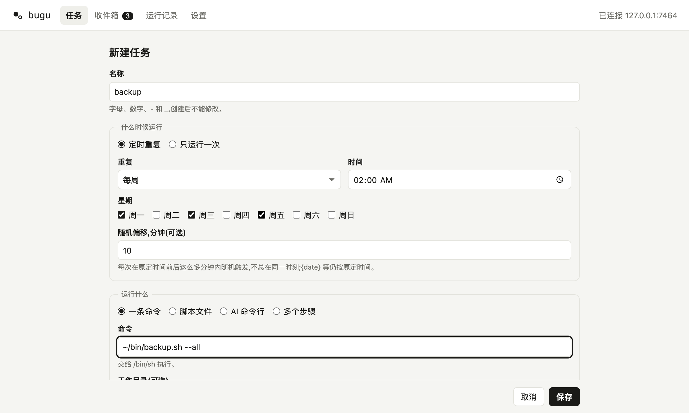

# Bugu 布谷

[English](README.md) | 简体中文

桌面优先的定时任务应用。不用写配置文件,就能让 Claude Code、Codex、Pi 等命令行 agent 或普通脚本按时干活,结果送到你面前。

名字取自布谷鸟:到点报时。


## 功能

- **三种用法**:常驻菜单栏的桌面应用、网页面板、命令行,连的是同一个后台。
- **脚本和 AI 命令行**:可以运行一条命令、一个脚本文件、带提示词的 AI 命令行,或把它们串成多个步骤,上一步的输出交给下一步。
- **不用写 cron**:在表单里选"工作日 09:00"这样的时间,会写 cron 的也可以直接填。每次可以在设定时间前后随机偏移。
- **结果送到面前**:每次运行的结果进收件箱,Markdown 输出直接排版;也可以发系统通知和 webhook。
- **默认安全**:AI 命令行默认只读,需要时再放开。环境变量文件里的密钥在输出、日志和通知里都会隐藏。
- **远程主机**:在自己的电脑上管理服务器上的布谷,每台机器单独发令牌。

选择什么时候运行,不用写 cron:



每次运行的结果进收件箱:


多步骤运行逐步显示状态:


## 构建

需要 Go 1.27 或更高版本。

```sh
make build    # 生成 bin/bugu
make app      # 打包桌面应用到 dist/(macOS)
```

## 开始使用

### 桌面应用

运行 `bin/bugu app`,或打开 `make app` 生成的应用包。关闭窗口后它留在菜单栏,任务照常运行。

### 命令行

```sh
bin/bugu serve                # 启动后台(桌面应用开着时不需要)
bin/bugu add backup --schedule "0 2 * * *" --command "~/bin/backup.sh"
bin/bugu list
bin/bugu run backup           # 不等到 2 点,立即试跑一次
bin/bugu runs
bin/bugu logs <运行编号>
```

### AI 命令行

```sh
bin/bugu runner check         # 本机装了哪些 AI 命令行、能否启动
bin/bugu add issues --schedule "0 9 * * 1-5" --runner claude --cwd ~/projects/site \
  --prompt "列出 {last_run} 之后的新 issue,按 bug、需求、提问分类。"
```

AI 命令行默认以只读方式运行;确实需要它修改文件时加 `--permission write_cwd`。

想让你自己的 AI agent 来建任务,把 `bin/bugu skill` 的输出存成那个 agent 的技能说明文件(Claude Code 是 `~/.claude/skills/bugu/SKILL.md`),它就会用 `bugu ... --json` 建任务、试跑、看结果。

### 服务器和远程主机

```sh
bin/bugu daemon install       # 把后台装成系统服务(macOS 用 launchd,Linux 用 systemd)
bin/bugu web                  # 没有桌面的机器上:启动后台并打开网页面板
bin/bugu token create laptop  # 在服务器上:为另一台电脑创建令牌
bin/bugu host add nas https://bugu.example.com --token -   # 在电脑上:登记那台服务器,令牌从标准输入读
bin/bugu --host nas list      # 对它执行命令;应用的设置页里也能打开它的面板
bin/bugu doctor               # 检查运行环境
```

界面和命令行的提示有中文和英文:执行 `bin/bugu language zh`,或在设置页里选。

全部命令见 `bin/bugu help`。

## 开发

```sh
make check    # 格式、静态检查、全部测试、交叉编译、前端检查和浏览器测试
```

`make check` 还需要 Node;第一次运行会为浏览器测试下载 Chromium。

- 需求:[docs/PRD.md](docs/PRD.md)
- 架构:[docs/ARCHITECTURE.md](docs/ARCHITECTURE.md)
- 设计决策:[docs/adr/](docs/adr/)
- 参与开发(人或 AI agent):[AGENTS.md](AGENTS.md)

## 许可

[MIT](LICENSE)
