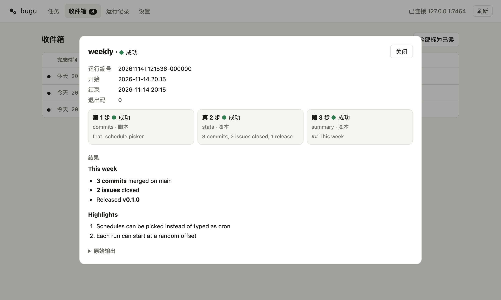

# Bugu 布谷

[English](README.md) | 简体中文

桌面优先的定时任务应用。不用写配置文件,就能让 Claude Code、Codex、Pi 等命令行 agent 或普通脚本按时干活,结果送到你面前。

名字取自布谷鸟:到点报时。


**状态:第一版功能已齐,等待验收。** 可以在桌面应用、浏览器或命令行里管理定时任务;任务可以是脚本、AI 命令行或由它们组成的多个步骤;结果进收件箱,也可以发系统通知和 webhook;可以管理服务器上的另一个布谷。进度见需求文档第 11 章。

- 需求与里程碑:[docs/PRD.md](docs/PRD.md)
- 架构:[docs/ARCHITECTURE.md](docs/ARCHITECTURE.md)
- 参与开发(人或 AI agent):[AGENTS.md](AGENTS.md)

## 截图

选择什么时候运行,不用写 cron;每次可以在设定时间前后随机偏移:


每次运行的结果进收件箱,失败的一眼就能看到:


多步骤运行逐步显示状态,Markdown 输出直接排版:



## 构建

需要 Go 1.27 或更高版本。

```sh
make build    # 生成 bin/bugu
make check    # 格式、静态检查、测试、交叉编译
make app      # 打包桌面应用到 dist/(macOS)
```

## 试用

桌面应用:运行 `bin/bugu app`,或打开 `make app` 生成的应用包。关闭窗口后它留在菜单栏,任务照常运行。

命令行:

```sh
bin/bugu serve                # 启动后台,保持运行(桌面应用开着时不需要)
bin/bugu add backup --schedule "0 2 * * *" --command "~/bin/backup.sh"
bin/bugu list
bin/bugu run backup           # 不等到 2 点,立即试跑一次
bin/bugu runs
bin/bugu logs <运行编号>
```

让 AI 命令行按时干活:

```sh
bin/bugu runner check         # 本机装了哪些 AI 命令行、能否启动
bin/bugu add issues --schedule "0 9 * * 1-5" --runner claude --cwd ~/projects/site \
  --prompt "列出 {last_run} 之后的新 issue,按 bug、需求、提问分类。"
```

AI 命令行默认以只读方式运行;确实需要它修改文件时加 `--permission write_cwd`。

让你自己的 AI agent 来建任务:把 `bin/bugu skill` 的输出存成那个 agent 的技能说明文件(Claude Code 是 `~/.claude/skills/bugu/SKILL.md`),它就会用 `bugu ... --json` 建任务、试跑、看结果。

服务器和远程管理:

```sh
bin/bugu daemon install       # 把后台装成系统服务(macOS 用 launchd,Linux 用 systemd)
bin/bugu web                  # 没有桌面的机器上:启动后台并打开网页面板
bin/bugu token create laptop  # 在服务器上为另一台电脑创建令牌
bin/bugu host add nas https://bugu.example.com --token -   # 在电脑上登记那台服务器,令牌从标准输入读
bin/bugu --host nas list      # 对它执行命令;应用的设置页里也能打开它的面板
bin/bugu doctor               # 检查运行环境
```

界面和命令行的提示有中文和英文:`bin/bugu language zh`,或在设置页里选。

全部命令见 `bin/bugu help`。

## 许可

[MIT](LICENSE)
